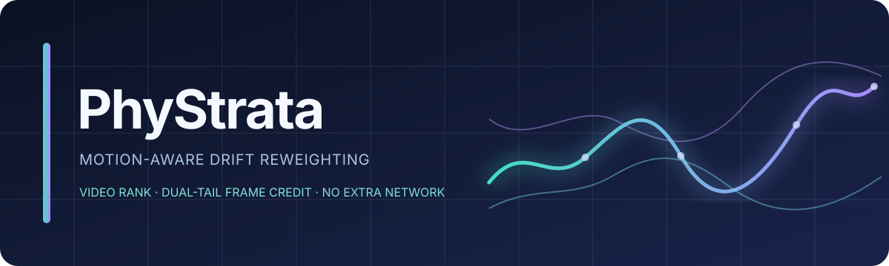
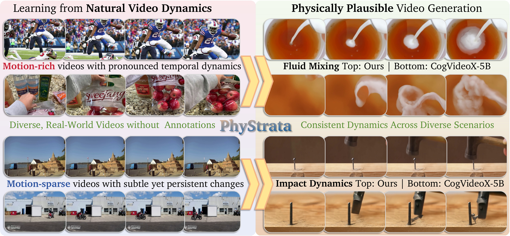

# PhyStrata

<p align="center"></p>

**Video-level motion weighting and dual-tail frame credit for physically coherent video generation**

<p align="center">
  
  
  
  
</p>

PhyStrata redistributes a video diffusion model's **drift supervision** across videos and temporal intervals. It gives relatively active videos more weight within the current global training batch, then assigns symmetric credit to low- and high-activity latent positions within each video. The denoising objective, predictor training objective, model architecture, and inference guidance are unchanged by this weighting rule.

This repository contains source code, reproducible 2B and 5B training recipes, inference, VideoPhy evaluation, and six selected generated examples. It includes small benchmark metadata; **pretrained models, adapters, training video corpora, and evaluator weights are not included.**

> **Research status.** This is an exploratory method and code release.

## At a glance

[](assets/phystrata-overview.pdf)

- **Video level:** midrank of each video's mean latent activity in the current distributed global batch.
- **Frame level:** symmetric credit from adjacent motion intervals, followed by a dual-tail rank transform and a dispersion gate.
- **Bounded change:** each interval multiplier lies in `[0.36, 1.96]`; the mean frame-level multiplier within a video is exactly `1`.
- **Lightweight:** no new network, teacher model, optical-flow estimator, or additional VAE forward pass.

The full derivation and edge cases are in [docs/method.md](docs/method.md).

## Generated examples

Selected videos generated with PhyStrata. Click an animated preview to view the full video.

| Water ripples | Pouring water | Breaking waves |
|:---:|:---:|:---:|
| [](assets/examples/example-01.mp4) | [](assets/examples/example-02.mp4) | [](assets/examples/example-03.mp4) |
| **Stirring soup** | **Boat at dock** | **Sailing** |
| [](assets/examples/example-04.mp4) | [](assets/examples/example-05.mp4) | [](assets/examples/example-06.mp4) |

## Installation

Linux, Python 3.10, and CUDA GPUs are recommended for training and generation. The reference environment uses PyTorch 2.6.0, torchvision 0.21.0, diffusers 0.33.0, and transformers 4.49.0. Install a CUDA-enabled PyTorch build suitable for your driver first, then:

```bash
git clone https://github.com/ShanwenTan/PhyStrata.git
cd PhyStrata
python -m venv .venv
source .venv/bin/activate
python -m pip install --upgrade pip
python -m pip install -r requirements.txt
python -m pip install -e .
```

`requirements.lock.txt` records the complete reference environment; it is not needed for a normal installation. The base CogVideoX weights and evaluator checkpoints must be obtained under their respective licenses and passed as local paths. See [docs/getting_started.md](docs/getting_started.md).

## Data and checkpoint layout

The public package intentionally contains no large files. Use any writable locations:

```text
/path/to/CogVideoX-2b-or-5b/     # Diffusers-format base model
/path/to/openvid64k.csv          # OpenVid metadata
/path/to/openvid/videos/         # Video files named in the CSV
/path/to/checkpoint/            # Adapter and predictor weights
  pytorch_lora_weights.safetensors
  predictor.safetensors
```

The dataset CSV must provide a caption field (`caption`, `text`, or `prompt`) and a video path field (`video`, `video_path`, `videopath`, `path`, `file`, `filename`, or `mp4`). Relative video paths resolve beneath `--video-root`. The reference recipe uses 49-frame, 480×720 training buckets and skips shorter clips.

## Training

`scripts/launch_train.py` validates paths, writes a resolved config beside the outputs, enables PhyStrata's drift weighting, and starts distributed training. A dry run validates the launch without loading a model:

```bash
python scripts/launch_train.py --size 2b \
  --model-path /path/to/CogVideoX-2b \
  --dataset-csv /path/to/openvid64k.csv \
  --video-root /path/to/openvid/videos \
  --output-dir /path/to/runs/phystrata-2b \
  --dry-run
```

Run the **2B reference recipe** on one 8-GPU node:

```bash
python scripts/launch_train.py --size 2b \
  --model-path /path/to/CogVideoX-2b \
  --dataset-csv /path/to/openvid64k.csv \
  --video-root /path/to/openvid/videos \
  --output-dir /path/to/runs/phystrata-2b \
  --nnodes 1 --nproc-per-node 8 \
  --wandb-project YOUR_WANDB_PROJECT
```

For the **5B reference recipe**, launch the same command on two 8-GPU nodes using a shared filesystem. On node 0 use `--node-rank 0`; on node 1 use `--node-rank 1`. Both commands need `--size 5b --nnodes 2 --nproc-per-node 8 --master-addr NODE_0_IP --master-port 29500`, the same paths, and the same output directory. The per-device batch is two, giving a global batch of 32. Authenticate with `wandb login` before enabling online tracking; no token belongs in the repository.

| Recipe | GPUs | Per-GPU batch | Global batch | Steps | Checkpoint interval | LoRA rank / alpha |
|---|---:|---:|---:|---:|---:|---:|
| 2B + OpenVid64K | 8 | 4 | 32 | 2,000 | 500 | 128 / 64 |
| 5B + OpenVid64K | 16 | 2 | 32 | 2,000 | 500 | 128 / 64 |

The global-batch video rank uses all distributed ranks at each step. Its comparison pool has 32 videos in both the 2B and 5B recipes. This is a deliberate batch-reference variant; it does not compute a fixed rank over the entire dataset.

## Inference

Point to a compatible base model and a directory containing the LoRA adapter and predictor weights:

```bash
CUDA_VISIBLE_DEVICES=0 python tests/generate_phystrata.py \
  --model_path /path/to/CogVideoX-5b \
  --lora_path /path/to/checkpoint \
  --prompt "A glass bowl fills with flowing water." \
  --output_file outputs/example \
  --num_frames 49 --num_inference_steps 50 \
  --guidance_scale 6.0 --guidance_lambda 15.0 \
  --guidance_step_ratio 0.8 --fps 8 --seed 42
```

The loader accepts predictor checkpoints with unprefixed keys or a single training namespace. Guidance and generation defaults match the reference inference path; the training-time weighting adds no inference parameters.

## Evaluation

The included VideoPhy CSV has 344 prompts. Obtain the VideoCon physics scorer separately, then run:

```bash
CUDA_VISIBLE_DEVICES=0,1 \
BASE_MODEL=/path/to/CogVideoX-5b \
CHECKPOINT_PATH=/path/to/checkpoint \
VIDEOCON_CHECKPOINT=/path/to/videocon_physics \
MODEL_TYPE=phystrata GENERATE_TYPE=lora \
WORKERS_PER_RANK=2 \
RESULT_PATH=outputs/eval/phystrata-5b-step500 \
bash eval/scripts/run_videophy_eval.sh
```

The evaluator writes generation metadata, per-prompt scores, and `result_summary.txt`. VideoPhy **SA** measures semantic adherence and **PC** measures physical commonsense. Use a fresh result directory for each checkpoint. Additional VideoPhy2 and VBench entrypoints remain under `eval/scripts/`; their separate evaluator weights are also external.

## Repository map

| Path | Purpose |
|---|---|
| `finetrainers/` | Model, predictor, drift loss, and training internals |
| `train/configs/` | Path-free 2B and 5B reference recipes |
| `scripts/launch_train.py` | Portable one- or two-node training launcher |
| `tests/generate_phystrata.py` | Text-to-video inference |
| `eval/scripts/` | VideoPhy, VideoPhy2, and VBench evaluation |
| `docs/` | Method, setup, and reproduction notes |

## Citation

See [CITATION.cff](CITATION.cff) for the software citation. A paper-specific citation should be added only when a PhyStrata manuscript is publicly available.
